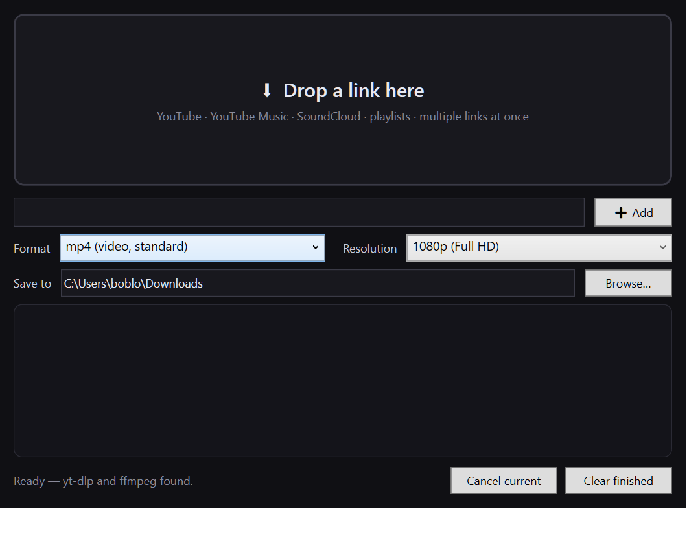

# Swoop

[](https://github.com/picklepicklepickplepickle/Swoop/actions/workflows/build.yml)



A tiny Windows app for saving YouTube videos and songs as actual files on
your disk. Drag links onto it (or paste them), pick a format and a
resolution, done. It doesn't re-encode anything — it talks to yt-dlp, which
does the real work.

I built it because every downloader app I tried was either wrapped in an
Electron shell, stuffed with ads, or both. Swoop is one WPF window and
a 0.2 MB exe.

## What it does

- Drag & drop YouTube / YouTube Music / SoundCloud links onto the window.
  Multiple links at once is fine. So is a `.txt` file full of them.
- Or just paste a link and hit Enter — one per line, or space-separated.
- Formats: `mp3` (320 kbps), `mp4`, `mov` (QuickTime), `m4a`, `wav`,
  `flac`, `aac`, `ogg`, `mkv`, `webm`.
- Resolutions from `Best available` down to `360p`. Audio formats ignore it.
- Files land in your Downloads folder by default; there's a Browse button
  if you want them somewhere else.
- Queue at the bottom shows progress per item. Cancel any item mid-flight.

Video formats download the best video + audio streams and merge them with
ffmpeg. mp3 and friends are transcoded from the best audio stream.

## Requirements

- Windows 10 or 11
- [.NET 8 Desktop Runtime](https://dotnet.microsoft.com/download/dotnet/8.0)
  (you very likely have this — the app won't start without it)
- [yt-dlp](https://github.com/yt-dlp/yt-dlp) and
  [ffmpeg](https://www.ffmpeg.org/download.html) on your PATH

If yt-dlp isn't found anywhere, Swoop downloads its own copy of it once
to `%LOCALAPPDATA%\Swoop\` and uses that. ffmpeg can't be
auto-downloaded right now — see Troubleshooting.

## Installing yt-dlp and ffmpeg

Open PowerShell (Win+X, then "Terminal") and paste:

```powershell
winget install yt-dlp.yt-dlp
winget install Gyan.FFmpeg
```

Close and reopen any open app windows afterwards (PATH changes need a
restart of the process). If `winget` isn't available on your install, grab
the two executables manually:

1. Download the newest `yt-dlp.exe` from
   <https://github.com/yt-dlp/yt-dlp/releases>.
2. Download an ffmpeg build from <https://www.gyan.dev/ffmpeg/builds/>
   (the "essentials" build is enough) and unzip it.
3. Drop `yt-dlp.exe` and `ffmpeg.exe` into a folder, e.g.
   `C:\tools\`, and add that folder to your PATH:
   Settings → System → About → Advanced system settings →
   Environment Variables → Path → New.

Swoop looks on the PATH first, then in the WinGet links folder. You can
check what it found in the status line at the bottom of the window.

## Using Swoop

1. Run the exe (see Releases below, or build it yourself — next section).
2. Paste a link into the box and press Enter, or drag one onto the window.
3. Pick a format with the left dropdown. Anything that ends in audio
   (mp3, m4a...) ignores resolution; video formats show it.
4. Pick a resolution. "Best available" takes whatever the source has —
   for most music videos that's 1080p, on newer uploads more.
5. Watch the row at the bottom. Percent fills up; when the dot turns green
   it's on your disk. Hover a row for yt-dlp's raw output if something
   looks off.

Playlists work the same way as a single video — paste the playlist URL and
yt-dlp will grab the whole thing, item by item, using one download at a
time (deliberately: faster just triggers YouTube rate limiting, and one
big video at a time is kinder to RAM).

## Building from source

Needs the .NET 8 SDK and Visual Studio 2022 (Community is fine):

```powershell
git clone https://github.com/picklepicklepickplepickle/Swoop.git
cd Swoop
dotnet build Swoop.sln
dotnet test tests/Swoop.Core.Tests/Swoop.Core.Tests.csproj
```

Or just open `Swoop.sln` in Visual Studio and hit F5. The tests include
two that do real network downloads of a short public video — don't panic
if they take ~10 seconds.

Release build (single-file, framework-dependent):

```powershell
dotnet publish src/Swoop -c Release -r win-x64 --self-contained false -p:PublishSingleFile=true -o dist
```

## How it works (short version)

`Swoop.Core` knows nothing about WPF. It figures out the arguments for
yt-dlp from your format/resolution choice, finds the exe (PATH, then the
WinGet links folder, then Downloads yt-dlp itself), starts the process, and
parses the `--newline` output for progress percent and the final file
location. The window in `src/Swoop` is just a thin skin over that.

One quirk worth knowing if you edit the code: yt-dlp prints `Destination:`
lines for *intermediate* files it later deletes when merging formats, so
the engine checks the file still exists before trusting that line, and
falls back to the newest file in the output folder.

## Troubleshooting

- **"ffmpeg missing — cannot transcode"** — you picked an audio format but
  ffmpeg isn't installed. Follow the install section above.
- **Nothing happens when I drop stuff** — only URLs are understood. Plain
  words are ignored on purpose; drag the link from the address bar, or the
  share-sheet URL from YouTube.
- **4K doesn't mean 4K** — YouTube only serves high resolutions in
  AV1/VP9 + Opus. Swoop grabs those and remuxes; if the source really
  doesn't have it, "Best available" tops out lower. Nothing is upscaled.
- **Locked-down work machines** — if group policy redirects `%LOCALAPPDATA%`
  somewhere the app can't reach, put `yt-dlp.exe` where IT allows it and
  make sure that folder is on the PATH. Swoop only runs what it finds.

## License

MIT — see [LICENSE](LICENSE). Do whatever, attribution appreciated.


